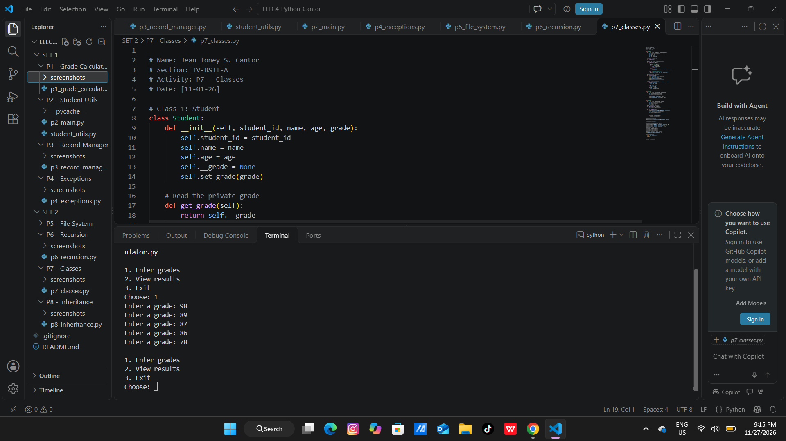
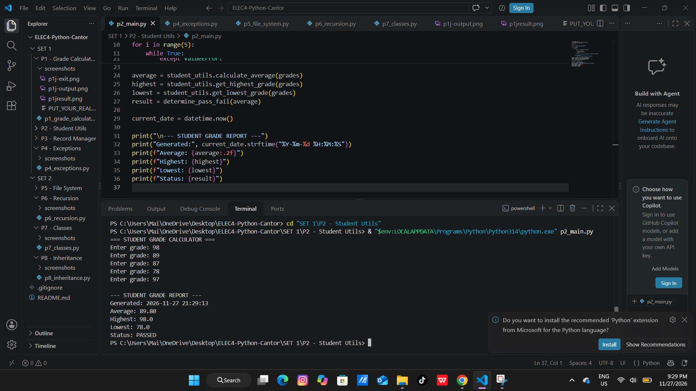
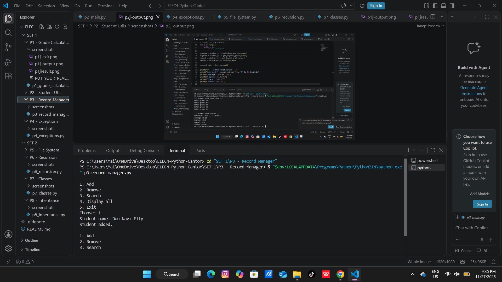
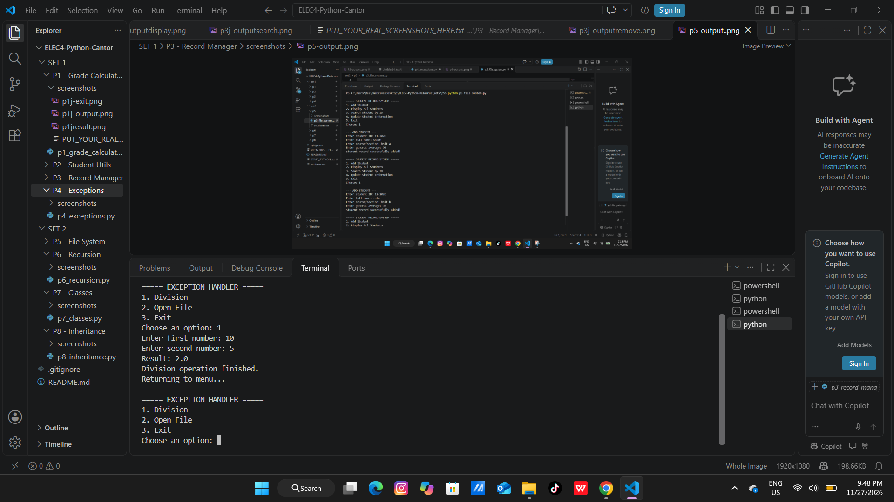

# ELEC 4 – Python Programming

**Name:** JEAN TONEY S. CANTOR  
**Section:** IV-BSIT-A  
**Course:** ELEC 4 – Python Programming

This repository contains the Python programming activities for Set 1 (P1–P4) and Set 2 (P5–P8).

## Set 1

### P1 – Grade Calculator
Functions and grade calculation.
- Folder: [set1/p1](set1/p1/)
- Run: `python set1/p1/p1_grade_calculator.py`

### P2 – Student Utils
Python modules and reusable student utility functions.
- Folder: [set1/p2](set1/p2/)
- Run: `python set1/p2/p2_main.py`

### P3 – Record Manager
Lists and sets for managing student records.
- Folder: [set1/p3](set1/p3/)
- Run: `python set1/p3/p3_record_manager.py`

### P4 – Exceptions
Exception handling in Python.
- Folder: [set1/p4](set1/p4/)
- Run: `python set1/p4/p4_exceptions.py`

## Set 2

### P5 – File System
File handling and exception handling.
- Folder: [set2/p5](set2/p5/)
- Run: `python set2/p5/p5_file_system.py`

### P6 – Recursion
Recursive functions in Python.
- Folder: [set2/p6](set2/p6/)
- Run: `python set2/p6/p6_recursion.py`

### P7 – Classes
Python classes and objects.
- Folder: [set2/p7](set2/p7/)
- Run: `python set2/p7/p7_classes.py`

### P8 – Inheritance
Inheritance and polymorphism in Python.
- Folder: [set2/p8](set2/p8/)
- Run: `python set2/p8/p8_inheritance.py`

## Screenshots

Screenshots are included in each activity's `screenshots` folder and represent program outputs.

## How to Run

Run the commands listed under each activity from the repository root directory using Python.
